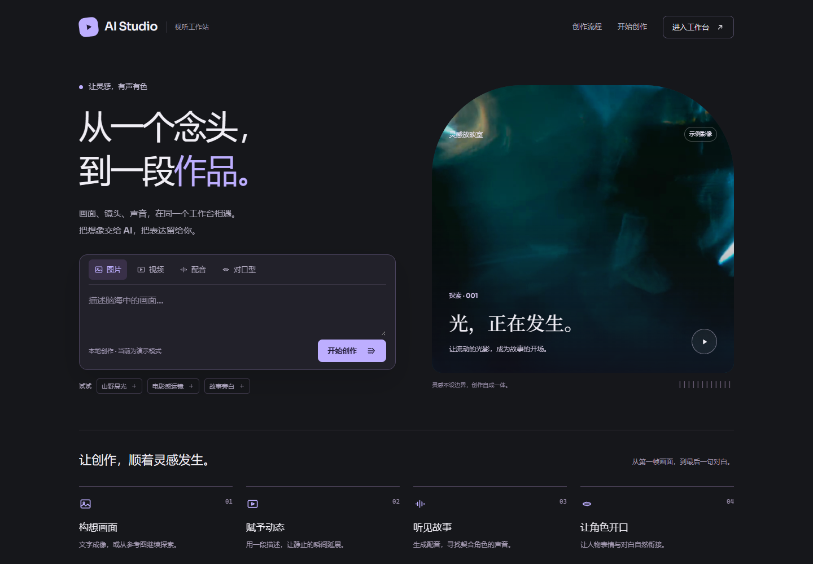
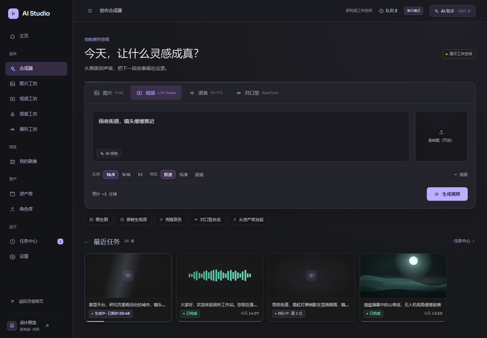

# AI Studio · 本地视听工作站

基于 Vue 3、TypeScript 和 Vite 的 AI 视听创作前端，覆盖图片、视频、配音与对口型四种工作流。
采用石墨灰、雾紫与冷白的界面配色，提供桌面与窄屏布局。

## 启动

环境：Node.js 20.19+ 或 22.12+，npm。

```sh
npm ci
npm run dev
```

开发地址以终端输出为准，默认 `http://127.0.0.1:5173`。

```sh
npm run build    # TypeScript 检查及生产构建
npm run preview  # 本机预览 dist，默认 http://127.0.0.1:4173
```

部署时发布 `dist/`，并将前端路径回退至 `index.html`，以支持 Vue Router history 路由。

## 真实登录（FastAPI）

后端位于 `../elf_project_backend`，先按该目录 README 启动 `http://127.0.0.1:8000`。然后让前端使用 live 模式：

```powershell
Copy-Item .env.example .env.local
# 将 VITE_API_MODE 改为 live
npm run dev
```

默认演示账号为 `demo` / `demo1234`，由后端 `.env` 决定。live 模式下：

- 登录调用 `POST /api/v1/auth/login`，token 存入 `localStorage`（记住我）或 `sessionStorage`。
- 进入受保护路由前，守卫调用 `GET /api/v1/auth/me` 校验 JWT；401 会清理会话并回到登录页。
- 退出调用 `POST /api/v1/auth/logout` 并清空本地会话。

`.env.local` 已被忽略，不会误提交；团队默认仍可用 `mock` 模式离线演示。

## 当前能力与边界

本仓库是**可交互的前端演示**，无需 ComfyUI、Ollama 或模型权重即可运行。
认证支持两种模式：默认 `mock`（任意非空凭据）与 `live`（FastAPI + JWT）；其余业务数据仍由 Pinia 模拟。

- 首页可选择创作类型、输入描述，并将草稿带入登录后的创作合成器。
- 图片、视频、语音、唇形工坊提供参数、素材选择和模拟任务反馈。
- 包含剧集、资产库、角色库、任务中心和设置页面。
- 任务在 Pinia 内模拟，部分播放、下载、服务检测及跨工坊操作仍是原型提示；示例图片为程序生成的占位画面。
- `.env.example` 和 `src/api/client.ts` 保留后端接口位置。设置 `VITE_API_MODE=live` 只启用真实认证，**不会自动启用真实推理**；任务与资产接口仍需按同一 `api` 对象迁移。
- `/dev/login` 为开发模式测试跳板，生产构建不包含该路由。

## 界面预览





## 目录

```text
src/
  views/        首页、登录、合成器、四个工坊及资源管理页
  shell/        导航、顶栏、工坊骨架、灯箱、消息与助手面板
  components/   表单、文件槽、任务卡、资产卡和图标
  stores/       模拟任务、资产、认证、能力与界面状态
  styles/       语义令牌、共享样式、运动及工作台视觉层
  router/       路由和模拟登录守卫
  api/          后端接口适配位置
public/media/   示例视频与海报，来源记录见 CREDITS.md
```

字体通过 npm 包自托管，页面不依赖字体 CDN。动效使用 CSS 与 GSAP，保留系统减少动态偏好规则；用户控制首页示例影像的播放和暂停。

## 维护约定

- 任务更新使用 jobs store 的 `patchJob()`，避免直接修改任务对象。
- 路由过渡采用纯 CSS；不要使用可能阻塞连续导航的 JS `done` 回调。
- GSAP 入场动画应有超时收尾，避免后台标签页停在隐藏状态。
- 共有内容列由 `--content-outer`、`--content-pad` 与 `--content-w` 组织。
- 下拉选项复用 `SelectMenu`，表单参数保持项目现有类型与语义。

## 已执行的验证

- TypeScript 检查与 Vite 生产构建通过。
- 无头 Chrome 实测首页草稿传递、模拟登录、任务提交、模式切换及高级参数展开。
- 检查桌面首页、工作台与图片工坊；巡检 390px 宽下四个工坊及资源管理页面，修复语音工坊和设置页的横向溢出。

以上验证针对前端模拟流程，未验证真实模型推理与生产环境认证。
